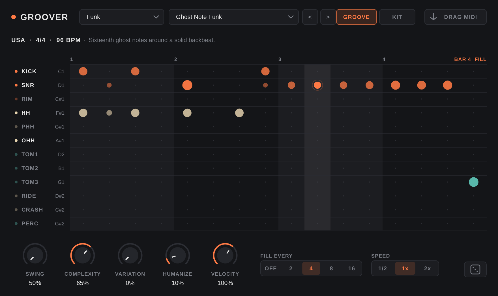
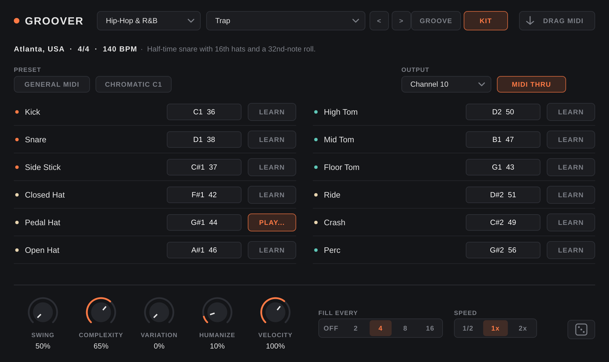

# Groover

A minimal MIDI groove generator plugin (VST3 / AU). Put it in front of any drum
instrument and it plays grooves from around the world in sync with the host,
with a few controls for feel and variation.



- **102 grooves in 16 categories**: Rock, Pop & Soul, Funk, Jazz, Blues & Shuffle,
  Hip-Hop & R&B, Electronic, Afro-Cuban, Brazilian, Latin America, Caribbean,
  African, Middle Eastern, Balkan, South Asian, Country & Folk. The grid handles
  straight, triplet and odd meters (5/4, 7/8, 9/8, 11/8, 12/8 and others).
- **12-part kit**: Kick, Snare, Side Stick, Closed / Pedal / Open Hat, High / Mid /
  Floor Tom, Ride, Crash and Perc. Every part can be mapped to any MIDI note, so
  the same groove can drive General MIDI kits, Drum Racks, BFD, Superior
  Drummer, Addictive Drums or a custom sampler.
- **Feel controls**: Swing, Complexity (strip back to a skeleton or add ghost notes
  and pickups), Variation (bar-to-bar changes), Humanize, Velocity, automatic
  Fills every 2/4/8/16 bars with a crash after, and half/double speed.
- **Drag MIDI**: drag the groove straight into a MIDI track as an 8-bar clip.

## Download

Prebuilt plugins are on the [Releases page](https://github.com/dbajpeyi/groover/releases).
The **nightly** pre-release is rebuilt from the default branch on every push;
tagged versions (`v0.1.0` and so on) get their own release.

| File | Contents | Install to |
| --- | --- | --- |
| `Groover-macOS.zip` | VST3 + AU, Apple Silicon and Intel | `~/Library/Audio/Plug-Ins/VST3` and `~/Library/Audio/Plug-Ins/Components` |
| `Groover-Windows-VST3.zip` | VST3 | `C:\Program Files\Common Files\VST3` |
| `Groover-Linux-VST3.zip` | VST3 | `~/.vst3` |

The builds aren't notarized. On macOS, if your DAW won't load them, clear the
download quarantine flag and rescan:

```sh
xattr -dr com.apple.quarantine ~/Library/Audio/Plug-Ins/VST3/Groover.vst3 ~/Library/Audio/Plug-Ins/Components/Groover.component
```

To publish a versioned release, push a tag: `git tag v0.1.0 && git push origin v0.1.0`.

## Using it in Ableton Live

Live doesn't let a plugin sit in front of an instrument on the same track, so use
two tracks:

1. Put **Groover** on a MIDI track (track A).
2. Put your drum instrument on a second MIDI track (track B).
3. On track B, set **MIDI From** to track A and pick **Groover** in the
   second dropdown. Set **Monitor** to **In**.
4. Press play. Groover follows Live's transport and tempo.

On macOS, use the VST3 version in Live if Groover doesn't show up as a
MIDI source when you load the AU.

Or skip the routing: drag **DRAG MIDI** into any MIDI track to get an 8-bar clip
you can edit.

## Mapping your kit

Open the **KIT** page. Each part has a note box (drag, scroll or double-click to
type `36` or `C1`) and a **LEARN** button: click it, then hit a pad or key on your
controller. **GENERAL MIDI** resets to the GM drum map, and **CHROMATIC C1**
assigns the parts in order from C1 (36) up, which suits Drum Racks and samplers.
Note names follow Ableton's convention (C3 = 60). You can also choose the output
channel and whether incoming MIDI passes through.



Click a part name on the GROOVE page to mute it.

## Controls

| Control | What it does |
| --- | --- |
| Swing | 50% straight, about 66% triplet, 75% dotted. Applies to 8th/16th grids; triplet grooves already swing. Picking a groove loads its usual swing. |
| Complexity | 50% plays the groove as written. Lower thins it down to the essentials; higher adds snare ghost notes, extra kicks and in-between hats. |
| Variation | 0% repeats exactly. Higher values change notes from bar to bar. |
| Humanize | Random timing (up to about 1/40 of a beat) and velocity changes. Never early on the downbeat. |
| Velocity | Overall velocity, 10–150%. |
| Fill every | Fill in the last bar of every 2, 4, 8 or 16 bars, then a crash on the next downbeat. |
| Speed | Half time, normal or double time against the host tempo. |
| Dice | New random seed, for a different take on embellishments, variations, fills and humanize. |

All of these, plus the groove choice and part mutes, can be automated.

## Building

Requires CMake 3.22+ and a C++17 compiler. JUCE 8 is downloaded automatically,
or point `JUCE_DIR` at a local checkout.

```sh
cmake -B build -DCMAKE_BUILD_TYPE=Release            # add -DJUCE_DIR=/path/to/JUCE to skip the download
cmake --build build --config Release
ctest --test-dir build -C Release                     # core engine tests
```

The plugins end up in `build/Groover_artefacts/Release/VST3` (and `AU` on macOS).
Copy them to your plugin folder, e.g. `~/Library/Audio/Plug-Ins/VST3` on macOS
or `C:\Program Files\Common Files\VST3` on Windows.

`-DGROOVER_MIDI_FX=ON` builds a MIDI-effect variant for Logic Pro's MIDI FX slot.

To look at the grooves without building the plugin:

```sh
cmake -B build-core -DGROOVER_BUILD_PLUGIN=OFF && cmake --build build-core
./build-core/groover_tests --list
./build-core/groover_tests --print "Afro-Cuban / Songo"
./build-core/groover_tests --print 0 0.8 0.3 4   # groove, complexity, variation, fill every
```

## Adding grooves

Grooves live in `Source/Core/GrooveLibrary.cpp` as one line of steps per part:

```cpp
add ({ "Rock", "Straight Eighths", "USA / UK", "4/4", 4, 16, 1, 110, 50, "Kick on 1 and 3, snare on 2 and 4." },
     { { H, "X.x. X.x. X.x. X.x." },
       { S, ".... X... .... X..." },
       { K, "x... .... x.x. ...." } });
```

The fields are category, name, origin, time signature, steps per quarter note,
steps per bar, bars, suggested tempo, suggested swing and a one-line note.
Step symbols: `.` rest, `g` ghost, `s` soft, `x` normal, `X` accent. Spaces are
ignored. Use 4 steps per quarter for 16ths, 3 for triplet feels (12/8 is written
as four beats of three), 2 for 8th-note grids and odd meters, and 8 for 32nds.
The tests check every groove's lane lengths against its meter.

## Layout

```
Source/Core/        engine and groove library (plain C++, no JUCE)
Source/UI/          look and feel, step grid, kit page, controls
Source/PluginProcessor.*  host sync, MIDI output, state
Source/PluginEditor.*     main window
Source/MidiExport.*       drag-and-drop MIDI files
Tests/CoreTests.cpp       engine and library tests
```
